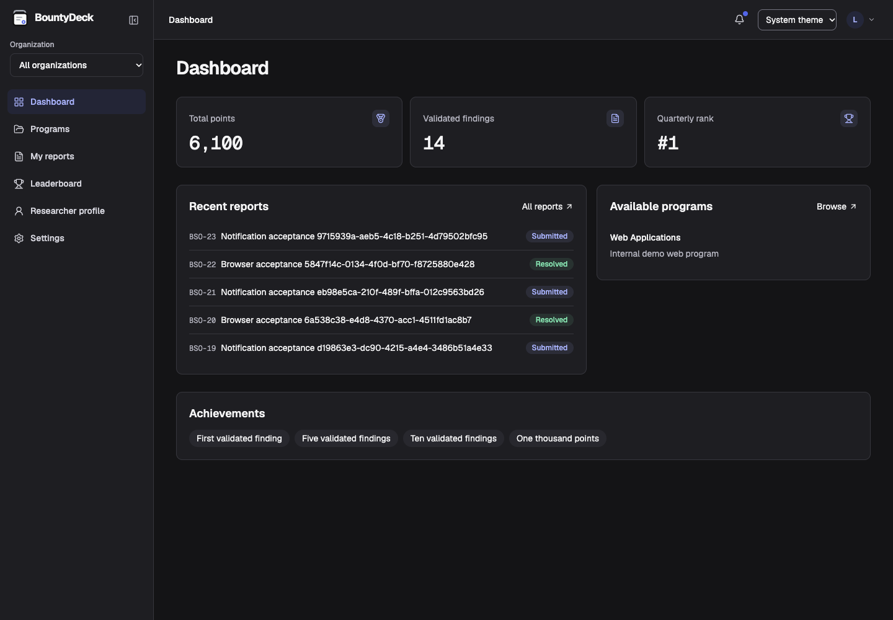
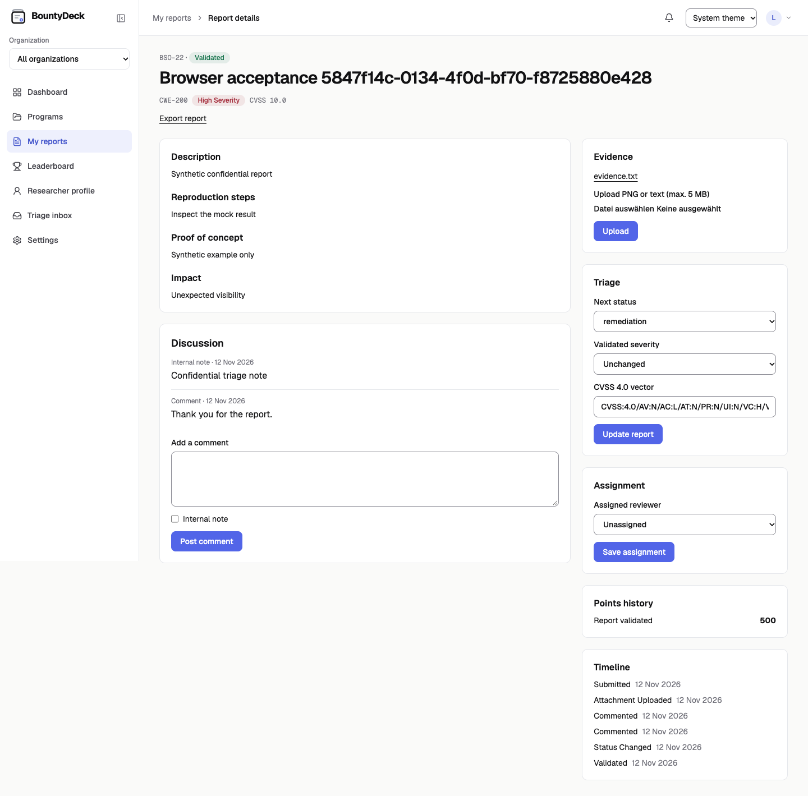
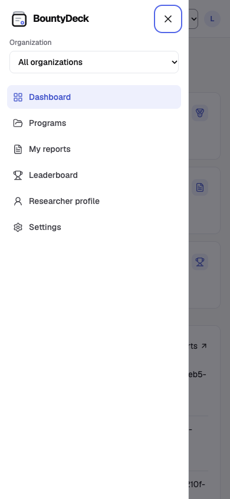

**Find vulnerabilities. Earn recognition.**

BountyDeck is a self-hosted platform for internal bug bounty programs. Employees submit confidential vulnerability reports, security teams triage them, and researchers earn points and recognition for validated findings. It supports English and German, OIDC sign-in, private evidence uploads, and email and webhook notifications.

## Screenshots





<details>
<summary>Mobile navigation</summary>



</details>

## Run BountyDeck

You’ll need Docker Engine or Docker Desktop, Docker Compose v2, and Git. This loopback setup includes Keycloak for sign-in. Add `127.0.0.1 bountydeck.test` to the hosts file on the computer where you’ll open the app.

```sh
git clone https://tea.karlcom.de/karl/bountydeck.git
cd bountydeck
cp .env.example .env
./deploy/init-secrets.sh keycloak
docker compose --profile keycloak pull postgres reverse-proxy keycloak
docker compose --profile keycloak build application
docker compose run --rm migrate
docker compose --profile keycloak up -d --no-build --wait
```

Open [BountyDeck](http://bountydeck.test). For a shared installation, follow the [HTTPS deployment guide](deploy/README.md#private-tls-deployment). The same guide covers [using your existing OIDC provider](deploy/README.md#external-oidc), [notifications](deploy/README.md#notifications), [backups](deploy/README.md#backup-and-restore), and [upgrades](deploy/README.md#upgrade-and-offline-operation).

### Set up your first administrator

1. Open the [Keycloak console](http://bountydeck.test/identity/admin/) and sign in as `bountydeck-bootstrap`. Its generated password is in `secrets/keycloak_admin_password`.
2. In the **bountydeck** realm, create a user and set their password. Copy the user ID, then sign in to BountyDeck once with that account.
3. Run the command below with that user ID. Reload BountyDeck to see **Administration**.

```sh
subject='<Keycloak user ID>'
docker compose run --rm migrate node db/grant-admin.ts \
  oidc:http://bountydeck.test/identity/realms/bountydeck "$subject"
```

For log ingestion, see the [Elastic and OpenTelemetry guide](docs/logging.md).

## Use BountyDeck

- **Platform administrators** create an organization in **Administration** and grant the organization administrator role. Users can copy their BountyDeck user ID from **Researcher profile** after their first sign-in.
- **Organization administrators** open **Organizations** to create a program. Add assets to its scope, set the testing rules and eligibility, assign triagers, and publish it.
- **Researchers** open **Programs**, choose an eligible program, and submit a finding. Open the report to add evidence, respond to questions, and follow its status.
- **Triagers** open **Triage inbox** to review findings, assign reports, and update their status. Validated reports award points based on the program’s scoring rules.

## Connect external tools

Use **Settings → Integrations** to find the REST and MCP endpoints and download Agent Skills. The [integration guide](docs/integrations.md) explains OAuth setup for user and automation identities.

BountyDeck is available under the [GNU AGPL v3.0 only](LICENSE).

### Anonymous guest reports

Set `BOUNTYDECK_GUEST_REPORTS=true` in `.env`, run the database migrations, and recreate the application container. The landing page then links to **Report anonymously**. This lists published programs open to all that have at least one in-scope asset. Program names, rules, and in-scope asset names are visible without signing in.

Guests can submit a report without giving an email address. Reviewers receive it in the normal triage inbox. Guests receive an on-screen confirmation and have no report history, replies, or points. All guests share a submission limit of ten reports per hour. Reverse proxies and hosting services may still record connection metadata.
